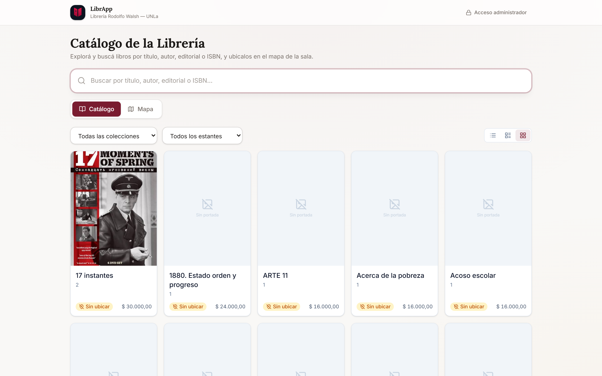
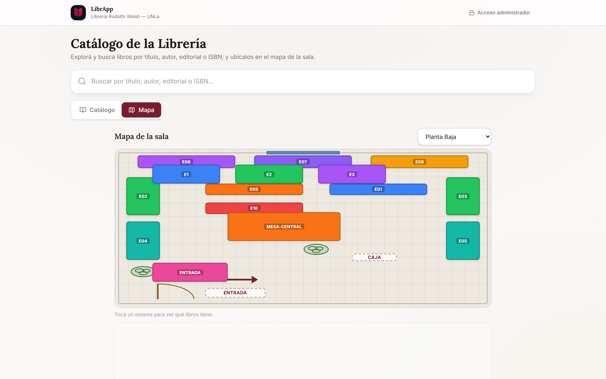
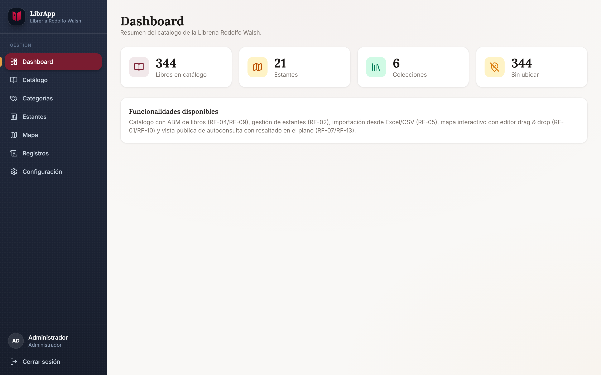
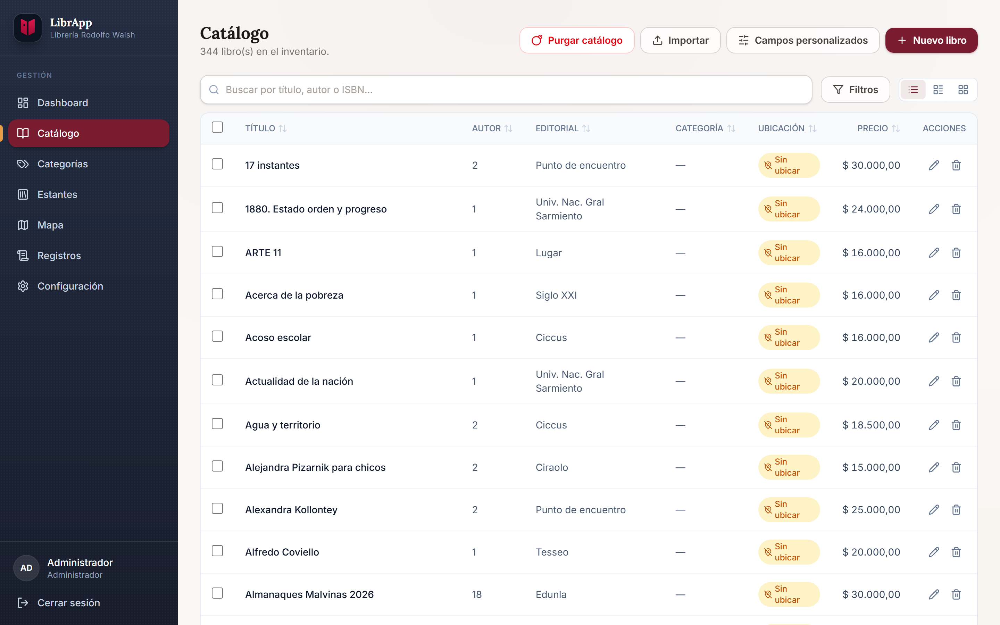
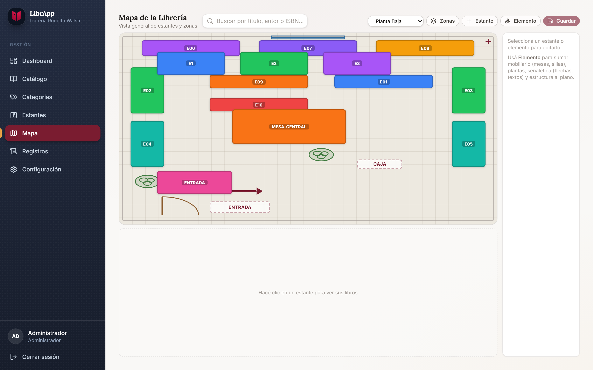
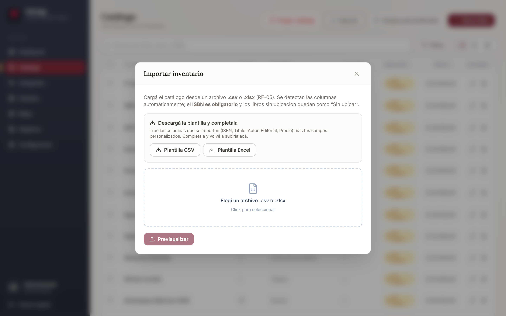
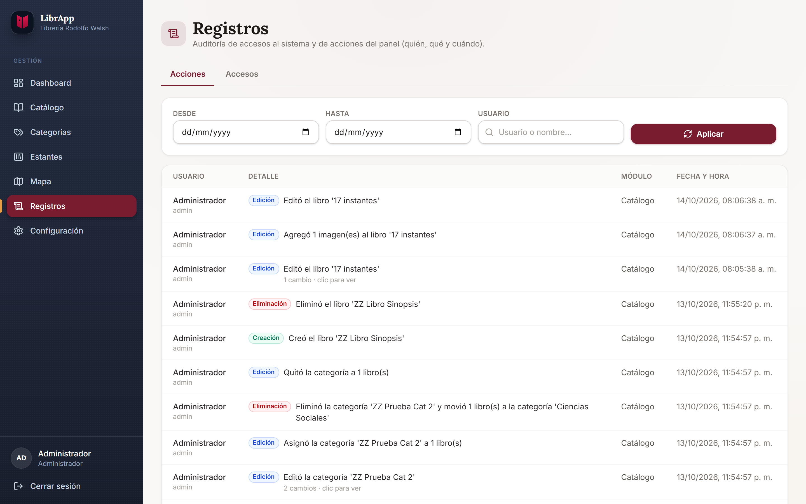
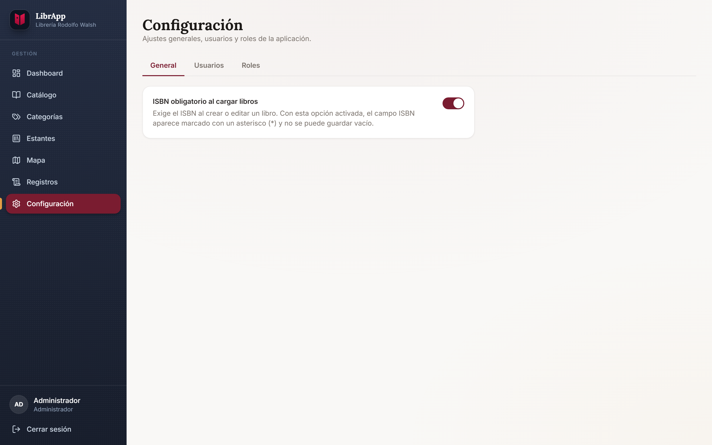
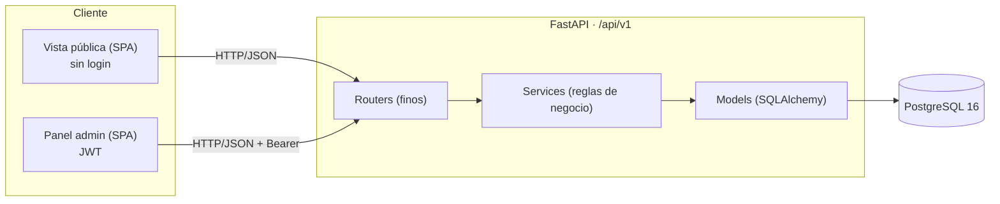
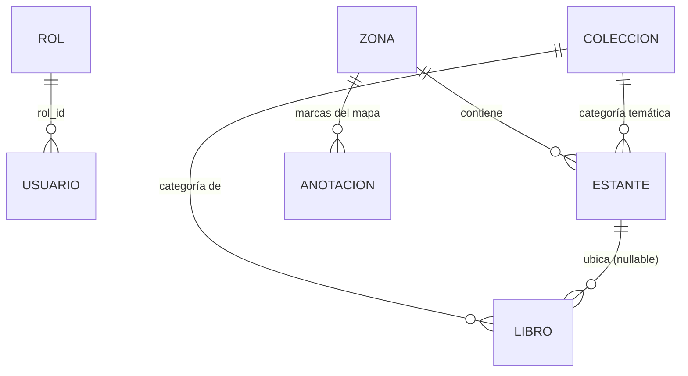

<div align="center">


# LibrApp

### Plataforma web de localización de libros — Librería *Rodolfo Walsh* (UNLa)

Catálogo bibliográfico vinculado a un **mapa 2D interactivo** de estantes, con
**autoconsulta pública sin login** y **panel de administración con JWT**.


</div>

---

> **Alcance:** localización y catalogación de ejemplares con su ubicación física.
> **Fuera de alcance** (definido en el Análisis Funcional): control de stock, facturación,
> remitos e ingreso de mercadería de proveedores.

## 📑 Tabla de contenidos

- [Contexto académico](#-contexto-académico)
- [Problema y objetivo](#-problema-y-objetivo)
- [Características principales](#-características-principales)
- [Capturas de pantalla](#-capturas-de-pantalla)
- [Stack tecnológico](#-stack-tecnológico)
- [Arquitectura](#-arquitectura)
- [Estructura del proyecto](#-estructura-del-proyecto)
- [Puesta en marcha](#-puesta-en-marcha)
- [Variables de entorno](#-variables-de-entorno)
- [Comandos útiles](#-comandos-útiles)
- [Modelo de datos](#-modelo-de-datos)
- [API y autenticación](#-api-y-autenticación)
- [Seguridad y autorización (RBAC)](#-seguridad-y-autorización-rbac)
- [Reglas de negocio](#-reglas-de-negocio)
- [Trazabilidad de requerimientos](#-trazabilidad-de-requerimientos)
- [Rutas de la aplicación](#-rutas-de-la-aplicación)
- [Estado del proyecto y roadmap](#-estado-del-proyecto-y-roadmap)
- [Autores y créditos](#-autores-y-créditos)
- [Licencia](#-licencia)

## 🎓 Contexto académico

Trabajo Final Integrador (TFI) de la **Licenciatura en Sistemas** de la
**Universidad Nacional de Lanús (UNLa)** — Departamento de Desarrollo Productivo y Tecnológico.

| | |
|---|---|
| **Institución** | Universidad Nacional de Lanús (UNLa) — Remedios de Escalada, Lanús |
| **Carrera** | Licenciatura en Sistemas |
| **Instancia** | Trabajo Final Integrador (TFI) — *Proyecto Librería Digital* |
| **Caso de estudio** | Librería "Rodolfo Walsh" (edificio *José Hernández*, campus UNLa) |
| **Metodología** | Enfoque ágil · tablero **Kanban** |
| **Versión del documento** | V2 — Septiembre 2026 |

La **fuente de verdad de los requerimientos** es el Análisis Funcional del TFI (identificadores
`RF-xx` / `RNF-xx` / `RN-xx` / `CU-xx`). El código referencia esos IDs en comentarios y este
README incluye su [trazabilidad](#-trazabilidad-de-requerimientos).

## 🎯 Problema y objetivo

**Problema.** En la librería la ubicación de cada libro reside únicamente en la memoria del
personal. Esto genera demoras de 2–3 minutos por consulta, nula autonomía del público
(depende de la asistencia verbal), inventario desactualizado ante reorganizaciones físicas y
datos fragmentados en planillas de Excel (~1.000 títulos) desvinculados del espacio real.

**Objetivo general.** Diseñar, desarrollar e implementar una plataforma web interactiva que
vincule dinámicamente el catálogo bibliográfico con un **mapa digital 2D** del local, para
optimizar los tiempos de atención, habilitar la **autoconsulta** del público y dotar al
personal de una herramienta ágil de administración del espacio físico.

**Objetivos particulares (resumen).** Relevar la distribución física y el inventario; diseñar
una interfaz web responsive con dos perfiles (Administrador / Público); autenticación por
roles; mapa interactivo con reorganización *drag & drop*; vista pública de autoconsulta por
título/autor/ISBN; ABM del catálogo; importación masiva desde Excel/CSV; arquitectura web sin
instalación local.

## ✨ Características principales

### Panel de administración (con login)
- **Catálogo (ABM)** de libros: alta/edición/baja, precio, sinopsis, categoría y ubicación;
  tabla con **búsqueda y filtros** (por categoría, estante o "sin ubicar").
- **Estantes:** ABM con código único por zona y categoría temática por estante.
- **Mapa 2D interactivo:** editor con **drag & resize** de estantes sobre un plano cenital,
  gestión de **zonas/pisos**, **anotaciones** de referencia (ENTRADA, CAJA, flechas, textos) y
  **guardado en lote** de posiciones.
- **Importador Excel/CSV:** tolerante a los archivos reales (fila de título, delimitador `;`,
  precios `$ 25.000,00`, columnas faltantes), con **previsualización (dry-run)** y upsert
  idempotente (deduplica por ISBN o por título+editorial).
- **Categorías** gestionables y **asignación en lote** a múltiples libros.
- **Usuarios y roles (RBAC):** roles dinámicos con permisos por sección.
- **Registros de auditoría** de las operaciones de escritura.
- **Dashboard** con KPIs del catálogo y **configuración** general.

### Vista pública (sin login)
- **Autoconsulta** del catálogo con búsqueda por título, autor, editorial o ISBN.
- Dos modos: **catálogo** (tarjetas/lista) y **mapa de la sala**.
- Al buscar, los estantes con coincidencias se **resaltan en el plano**; si están en otro piso,
  se indica en qué zona.
- **No se muestran precios** en la vista pública.

## 📸 Capturas de pantalla

| Autoconsulta pública (catálogo) | Autoconsulta pública (mapa) |
|---|---|
|  |  |

| Dashboard | Catálogo (ABM) |
|---|---|
|  |  |

| Editor de mapa 2D | Importador Excel/CSV (modal del catálogo) |
|---|---|
|  |  |

| Registros de auditoría | Configuración · Usuarios · Roles |
|---|---|
|  |  |

## 🧰 Stack tecnológico

| Capa | Tecnologías |
|---|---|
| **Backend** | Python 3.12 · FastAPI 0.115 · SQLAlchemy 2.0 · Alembic 1.14 · Pydantic 2 · Uvicorn |
| **Base de datos** | PostgreSQL 16 |
| **Auth** | JWT (`python-jose`) · hashing con `bcrypt` (`passlib`) |
| **Import** | `openpyxl` (XLSX) · parser CSV propio tolerante |
| **Frontend** | React 18.3 · Vite 6 · TypeScript 5.7 · Tailwind CSS v4.1 · TanStack Query 5 · React Router 6 · axios · lucide-react |
| **Infraestructura** | Docker Compose (db + backend + frontend) |

## 🏗 Arquitectura

Monorepo con **arquitectura en capas** y **API REST**. El frontend es una **SPA** que consume
la API bajo `/api/v1`; la autenticación es por **JWT Bearer**. El esquema de base de datos lo
gobierna **Alembic** (migraciones), no `create_all`.



**Patrón modular por feature** (backend): cada módulo es
`modules/<x>/{models,schemas,router,service}.py`. La lógica de negocio vive en `service.py`;
el router es fino. El dominio principal está en el módulo `catalogo` (libros, estantes, zonas,
colecciones/categorías, anotaciones, importador).

**Frontend feature-first:** `modules/<x>/` con su página y API; estado de servidor con
**TanStack Query**; instancia axios única que deriva la base URL del host (funciona desde
`localhost` o desde otro dispositivo en la red sin configurar nada).

## 📁 Estructura del proyecto

```
LibrApp/
├── docker-compose.yml            # db + backend + frontend
├── CLAUDE.md                     # guía técnica del repo
├── docs/screenshots/             # capturas usadas en este README
├── backend/
│   ├── app/
│   │   ├── core/                 # config, database, security (JWT), deps
│   │   ├── shared/               # Base/mixins (UUID, timestamps), exceptions
│   │   ├── modules/
│   │   │   ├── auth/             # login, permisos
│   │   │   ├── catalogo/         # libros, estantes, zonas, categorías, mapa, importer
│   │   │   ├── dashboard/        # KPIs
│   │   │   ├── usuarios/         # ABM de usuarios y roles (RBAC)
│   │   │   ├── configuracion/    # ajustes generales
│   │   │   └── auditoria/        # registros de actividad
│   │   ├── seed.py               # datos idempotentes de desarrollo
│   │   └── main.py               # app FastAPI, routers, middlewares, lifespan
│   ├── alembic/versions/         # migraciones de esquema
│   └── scripts/db_migrate.py     # aplica migraciones al arrancar
└── frontend/
    └── src/
        ├── app/                  # App, providers (Query/Router/Auth), rutas
        ├── modules/              # auth, dashboard, public, catalogo, mapa,
        │                         #   configuracion, usuarios, auditoria
        ├── shared/               # componentes UI, AdminLayout, ProtectedRoute, types
        └── lib/                  # axios (api), utils (cn, colores de estante)
```

## 🚀 Puesta en marcha

**Requisitos:** Docker Desktop.

```bash
docker compose up --build        # primera vez / tras cambiar dependencias
docker compose up -d             # levantar en background
```

Al arrancar, el backend **aplica las migraciones Alembic** y, en desarrollo, **siembra datos
idempotentes** (usuario admin + zonas + categorías + estantes + libros demo).

| Servicio | URL |
|---|---|
| Frontend | <http://localhost:5175> |
| Backend (API) | <http://localhost:8000> |
| Documentación API (Swagger) | <http://localhost:8000/docs> |
| Health check | <http://localhost:8000/health> |
| PostgreSQL | `localhost:5434` (usuario/pass `librapp`) |

> Los puertos 5175/8000/5434 están elegidos para convivir con otros proyectos en la misma
> máquina.

**Credenciales de administrador (seed de desarrollo):**

- Usuario: `admin`
- Contraseña: `Admin1234!`

(Configurables en `backend/.env` → `ADMIN_USERNAME` / `ADMIN_PASSWORD`.)

## ⚙️ Variables de entorno

Backend (`backend/.env`, ver `backend/.env.example`):

| Variable | Descripción | Default (dev) |
|---|---|---|
| `APP_NAME` | Nombre de la app | `LibrApp` |
| `ENV` | Entorno (`development` habilita Swagger y seed) | `development` |
| `DEBUG` | Modo debug | `true` |
| `CORS_ORIGINS` | Orígenes permitidos (coma-separados; `*` en dev) | `*` |
| `DATABASE_URL` | Cadena de conexión a PostgreSQL | `postgresql://librapp:librapp@db:5432/librapp_db` |
| `JWT_SECRET_KEY` | Secreto de firma JWT (**cambiar en prod**) | `changeme-jwt-secret` |
| `JWT_ALGORITHM` | Algoritmo JWT | `HS256` |
| `ACCESS_TOKEN_EXPIRE_MINUTES` | Expiración del token | `480` |
| `ADMIN_USERNAME` / `ADMIN_PASSWORD` | Admin inicial (seed idempotente) | `admin` / `Admin1234!` |
| `RUN_SEED_ON_STARTUP` | Forzar seed fuera de `development` | `false` |

Frontend (`frontend/.env`): `VITE_API_URL` se deja **sin definir en dev** a propósito — el
frontend deriva la API del host desde el que se abre (localhost en la PC o la IP de la PC desde
el celular en la red). En producción se setea explícita.

## 🛠 Comandos útiles

```bash
docker compose logs -f backend                               # ver logs
docker compose down                                          # bajar (agregar -v para BORRAR la DB)

# Typecheck del frontend (Vite no chequea tipos):
docker compose exec -T frontend npx tsc --noEmit

# Migraciones Alembic (dentro del contenedor):
docker compose exec backend alembic revision --autogenerate -m "descripcion"
docker compose exec backend alembic upgrade head             # el arranque ya lo corre
```

## 🗃 Modelo de datos



Entidades principales:

- **Usuario / Rol** — `Rol` tiene `permisos` (JSONB); cada `Usuario` tiene `rol_id`.
- **Zona** — pisos/sectores del local; contiene estantes y anotaciones del mapa.
- **Colección** — ⚠️ es lo que la **UI llama "Categoría"** (mismo concepto, `RN-10`). Un libro
  tiene su categoría y un estante puede tener su categoría temática.
- **Estante** — posición en el mapa (coordenadas % 0–100), color propio o derivado de la zona.
- **Libro** — título/autor/editorial/ISBN, precio, **sinopsis**, `coleccion_id` y `estante_id`
  (nulo = "Sin ubicar").
- **AnotaciónMapa** — marcas de referencia (`texto`/`flecha` con rotación): ENTRADA, CAJA, etc.
- **Auditoría** — registro de las operaciones de escritura.

## 🔌 API y autenticación

- Todas las rutas cuelgan de **`/api/v1`**.
- **Swagger / OpenAPI** en `/docs` (solo en `ENV=development`).
- Login por **JWT**: el token se envía como `Authorization: Bearer <token>`; el frontend lo
  guarda en `localStorage` y un `401` lo limpia.
- **Lectura del catálogo es pública** (vista de autoconsulta); toda **escritura** exige token
  y permiso.
- Routers por módulo: `auth`, `catalogo`, `dashboard`, `configuracion`, `auditoria`,
  `usuarios`. Health en `/health`.

## 🔒 Seguridad y autorización (RBAC)

**Roles dinámicos** (tabla `roles`, columna `permisos` JSONB). Catálogo fijo de permisos, una
clave por sección:

| Permiso | Habilita |
|---|---|
| `catalogo.gestionar` | ABM de libros y categorías |
| `estantes.gestionar` | ABM de estantes |
| `mapa.gestionar` | Editor de mapa, zonas y anotaciones |
| `importar.ejecutar` | Importación Excel/CSV |
| `registros.ver` | Registros de auditoría |
| `configuracion.editar` | Ajustes generales |
| `usuarios.gestionar` | ABM de usuarios y roles |
| `"*"` | Acceso total (rol de sistema "Administrador") |

Otras medidas: **security headers** (`X-Content-Type-Options`, `X-Frame-Options`,
`Referrer-Policy`, y `HSTS` en prod); CORS parametrizable; y versiones de dependencias fijadas
para mitigar CVEs conocidos (`python-jose` 3.4.0, `python-multipart` 0.0.18).

## 📐 Reglas de negocio

- **RN-01** — ISBN único entre libros (409 si se duplica).
- **RN-02** — título, autor y editorial obligatorios.
- **RN-04** — código de estante único por zona.
- **RN-05** — toda escritura (ABM, import, guardar posiciones) requiere permiso; la lectura del
  catálogo es pública.
- **RN-07 / RN-09** — `estante_id` nulo = "Sin ubicar"; el import deja así lo que no matchea.
- **RN-08** — no se elimina un estante con libros ni una zona con estantes (409). Las categorías
  sí se borran: nunca borran libros, los **reasignan**.
- **RN-10** — categorías ("colecciones") gestionables, reutilizadas para libros y estantes.
- **Usuarios/roles** — username único; no podés eliminar tu propia cuenta ni quitarte el permiso
  de gestión; siempre debe quedar ≥1 usuario activo con `usuarios.gestionar`; el rol de sistema
  no se edita ni elimina; no se elimina un rol con usuarios asignados.

## ✅ Trazabilidad de requerimientos

| ID | Requerimiento / Caso de uso | Estado | Dónde |
|---|---|---|---|
| RF-01 | Mapa 2D con estantes clicables | ✅ | `/admin/mapa`, vista pública |
| RF-02 | ABM de estantes/secciones | ✅ | `/admin/estantes` |
| RF-03 | Popup con los libros de un estante | ✅ | mapa (admin/público) |
| RF-04 / RF-06 / RF-09 | ABM de libros (alta/edición/baja, precio) | ✅ | `/admin/catalogo` |
| RF-05 | Importación masiva Excel/CSV con dry-run | ✅ | modal "Importar" en `/admin/catalogo` · CU-04 |
| RF-07 | Vista pública de autoconsulta (sin login) | ✅ | `/` |
| RF-08 | Autenticación por roles / RBAC | ✅ | `/admin/configuracion` (Usuarios/Roles) |
| RF-10 / RF-11 | Editor drag & drop · múltiples zonas/pisos | ✅ | `/admin/mapa` · CU-05 |
| RF-13 | Resaltado de coincidencias en el mapa | ✅ | vista pública |
| RF-14 | Vista kiosco full-screen para la entrada | ⏳ Pendiente (prioridad baja) | — |
| RN-01…RN-10 | Reglas de negocio | ✅ | ver [Reglas de negocio](#-reglas-de-negocio) |

## 🧭 Rutas de la aplicación

| Ruta | Descripción |
|---|---|
| `/` | Autoconsulta pública (RF-07) |
| `/login` | Login del administrador |
| `/admin` | Dashboard con KPIs |
| `/admin/catalogo` | ABM de libros + importador Excel/CSV (modal) (RF-04/RF-06/RF-09, RF-05/CU-04) |
| `/admin/categorias` | Gestión de categorías (RN-10) |
| `/admin/estantes` | ABM de estantes (RF-02) |
| `/admin/mapa` | Editor de mapa 2D (RF-01/RF-10/RF-11) |
| `/admin/registros` | Registros de auditoría (`registros.ver`) |
| `/admin/configuracion` | Ajustes + pestañas Usuarios y Roles (RF-08) |

## 🗺 Estado del proyecto y roadmap

- ✅ **Entrega 1** — Base end-to-end: login JWT → Dashboard; modelo de datos y lectura pública.
- ✅ **Entrega 2** — ABM de catálogo + importador Excel/CSV idempotente con dry-run.
- ✅ **Entrega 3** — Mapa interactivo 2D (estantes clicables, editor drag & drop, resaltado).
- ✅ **Entrega 4** — Múltiples zonas/pisos, anotaciones del mapa, categorías gestionables,
  usuarios/roles (RBAC) y auditoría.
- ⏳ **Próximo** — Vista kiosco full-screen para la entrada de la librería (RF-14, baja).

## 👥 Autores y créditos

Trabajo Final Integrador — Licenciatura en Sistemas, UNLa.

- Cordeiro, Cecilia Anabel
- Fernandez Breda, Sol Belén
- Gonzalez, Roberto Tomás
- Santander, Cristian

**Tutor:** Perez, Nicolás.

## 📄 Licencia

Proyecto desarrollado con fines **académicos** en el marco del Trabajo Final Integrador de la
Licenciatura en Sistemas (UNLa). Uso educativo; todos los derechos reservados por sus autores.
